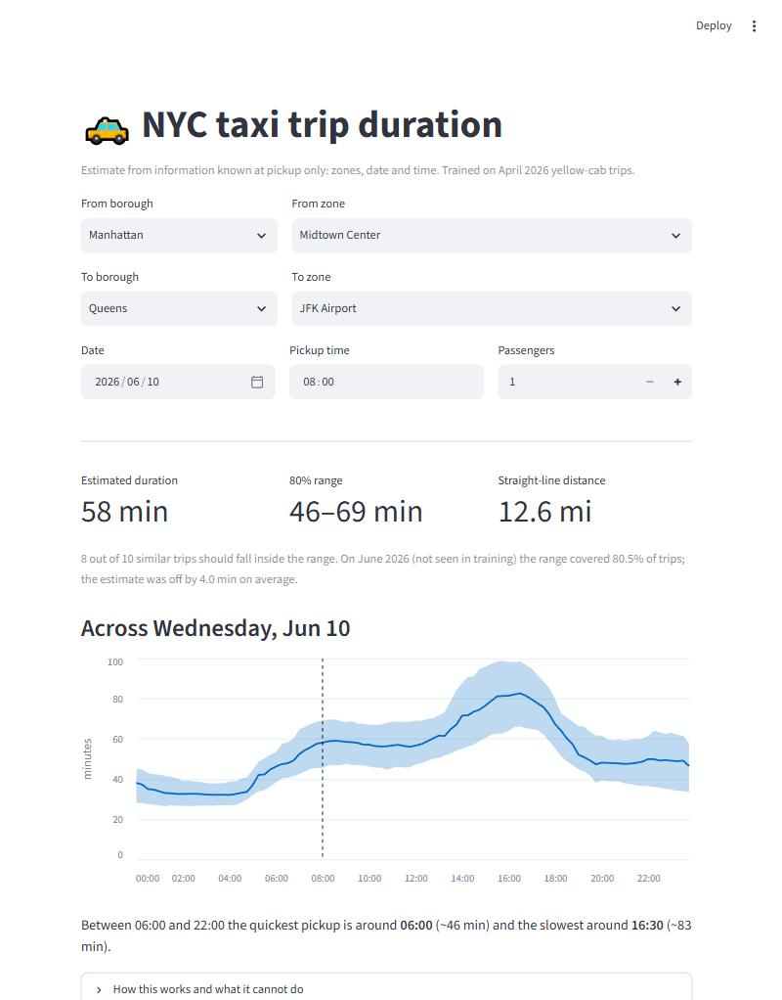
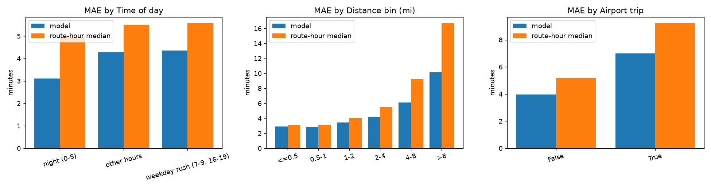

# NYC Taxi Trip Duration

  [](https://github.com/Venius24/ML-DATA/actions/workflows/tests.yml) 

Predicts how long a NYC yellow taxi ride will take **using only what is known at pickup** (time, pickup and dropoff zone),
together with an **80% range** for the ride. Trained on April 2026, then tested on months the model never saw:
May (v1, ~4M trips) and June (v2, ~3.7M trips), each opened exactly once.

**Why it matters:** an ETA shown to a rider or used for dispatch is only useful if it holds up on future days.
This project is about measuring that honestly: no leaked features, time-ordered validation, frozen test months.

## Results

| model | May 2026, MAE / RMSE (min) | June 2026, MAE / RMSE (min) |
|---|---:|---:|
| global median | 10.01 / 16.05 | 8.97 / 13.51 |
| median by route and hour (all April trips) | 4.92 / 8.35 | 4.43 / 7.05 |
| Ridge (log target, zone geometry) | 5.11 / 8.19 | not run |
| **v1:** LightGBM, 500k-trip sample | **4.36 / 6.97** | 4.07 / 6.26 |
| **v2:** LightGBM, all 3.74M trips, bigger trees | not run (May was spent on v1) | **4.01 / 6.16** |

- **v2 vs the route-hour median:** 9.6% lower MAE and 12.6% lower RMSE on June; better on 28 of 30 days.
- **v2 vs v1:** 1.6% lower MAE, better on all 30 June days. Small, as the learning curve predicted.
- June is an easier month than May for every model (even the global median), so compare models **within** a column, not across.

**80% interval (v2):** on June it covers **80.5%** of trips (target 80%) with a mean width of **12 min**.
Instead of a single number the model returns a range that contains the real duration 8 times out of 10: about 10 min wide
for short hops and 20 min for trips over 8 miles. The range comes from two quantile models (P10, P90) calibrated with
conformalized quantile regression (CQR); details in [docs/methodology.md](docs/methodology.md#v2-all-training-trips-and-prediction-intervals).

All numbers come from scripts in this repo ([`reports/final_results.md`](reports/final_results.md),
[`reports/final_results_v2.md`](reports/final_results_v2.md)); none are typed by hand.

## Interactive demo



A small Streamlit app ([`app/streamlit_app.py`](app/streamlit_app.py)) runs the v2 models: pick two zones, a date and a pickup
time, and it shows the estimate, the calibrated 80% range, and how both change across the day.

```bash
pip install -r app/requirements.txt
streamlit run app/streamlit_app.py   # downloads the trained models from the GitHub release on first start
```

To retrain the app models yourself: `python scripts/train_app_models.py` (about an hour on 12 threads; `--quick` for a rough
one-minute version).

## Why these numbers can be trusted

- **No leakage.** Trip distance, fare, tips and dropoff time are never features. A guard in code (`assert_no_leakage`) and tests enforce it.
- **Time-ordered validation.** 5 expanding-window folds inside April; each fold trains only on trips that ended before validation starts (3-hour gap).
- **Each test month is opened once.** All choices (model, size, interval calibration) are made by CV first; the evaluation scripts refuse to run twice.
  The v2 choices were [committed and pushed](https://github.com/Venius24/ML-DATA/commit/fe97593) before June was opened.
- **Two independent holdouts.** v1 was tested on May; v2 on June. v1 was re-run on June too, so v1 vs v2 is compared on identical data.
- **Reproducible.** Fixed seeds, deterministic LightGBM, pinned versions; one command rebuilds every report.

## How the model got better: v1 to v2

| step (all CV on April, MAE min, mean ± std over 5 folds) | MAE |
|---|---:|
| route-hour median baseline (500k sample) | 5.481 ± 0.134 |
| v1: LightGBM, 500k-trip sample, 127 leaves, 600 trees | 4.203 ± 0.110 |
| same model, 2M trips | 4.139 ± 0.110 |
| same model, all 3.74M trips | 4.124 ± 0.102 |
| **v2: all 3.74M trips, 255 leaves, 600 trees** | **4.106 ± 0.099** |

More data helps with diminishing returns; larger trees help a little once the data is there. Differences between the top
configurations are smaller than the fold-to-fold spread, so the pre-declared rule "lowest mean CV MAE" picks the winner.
Details: [`reports/learning_curve.md`](reports/learning_curve.md), [`reports/cv_v2.md`](reports/cv_v2.md).

## Where the model struggles



- **Long trips**: ~10 min MAE beyond 8 miles; zones and hour cannot see route choice or traffic. The 80% interval covers only 74% of these on June.
- **Airports** (JFK, LaGuardia): highway congestion we have no data for.
- **Drift**: trips got longer over April, so models trained on earlier days under-predict. Weighting recent trips helped a little.
- **Holidays**: April has none, so on Memorial Day (May) the model gained only 1% over the baseline.

## Quick start

```bash
pip install -r requirements.txt
python scripts/download_data.py   # ~200 MB of public TLC data (Apr, May, Jun), not stored in the repo
pytest -q                          # 28 tests
python scripts/run_all.py          # EDA, CV, error analysis, both final evaluations, summary
```

Want a quick look first? [notebooks/demo.ipynb](notebooks/demo.ipynb) trains the final model in ~20 s and asks it about real
routes (Midtown to JFK at rush hour vs 3 am, and more). It renders on GitHub with outputs; to run it yourself,
`pip install jupyter` and download April only: `python scripts/download_data.py 2026-04`.

## Project layout

```
src/taxi/   data cleaning, features, zone geometry, models, CV, prediction intervals
scripts/    one script per step (eda, run_cv, run_cv_v2, error_analysis, final_eval, final_eval_v2, ...)
tests/      cleaning rules, leakage guard, CV folds, intervals, pipeline smoke
notebooks/  demo: train the model and query real routes
app/        Streamlit demo with estimate and 80% range
reports/    generated tables and plots
docs/       full methodology
```

## More detail

The full write-up is in [docs/methodology.md](docs/methodology.md): cleaning rules with row counts, EDA findings,
every CV experiment, the error analysis, the v2 changes and interval calibration, and the limits of these results.

**Data:** NYC TLC yellow taxi trip records ([source](https://www.nyc.gov/site/tlc/about/tlc-trip-record-data.page)).
The data is downloaded by script and not redistributed here; check the TLC terms before reusing it. The code is MIT-licensed ([LICENSE](LICENSE)).
