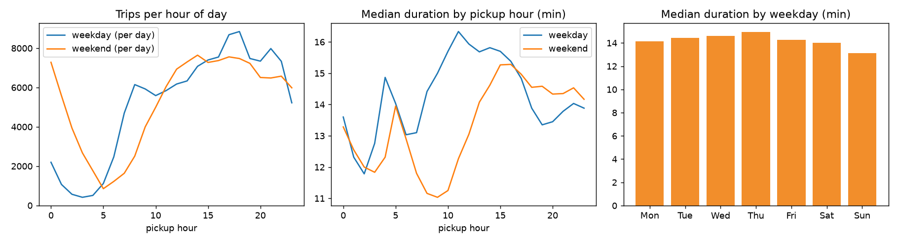

# Methodology and full results

Full write-up behind the short [README](../README.md): data, leakage rules, cleaning, every CV experiment, error analysis and limits.

Predict how long a NYC yellow taxi trip will take (pickup to dropoff, in minutes) using only information
available **at pickup time**, then check it on a month the models never saw.

Every number here was produced by a script in this repo; the file each one comes from is named next to it.
Raw data is not committed - `scripts/download_data.py` fetches it.

## Headline result (v1)

This section and the ones after it describe v1 (500k-trip sample, tested on May). v2 (all trips, prediction intervals,
tested on June) has [its own section](#v2-all-training-trips-and-prediction-intervals).

Held-out month **2026-05** (3,996,039 cleaned trips), models trained on a 500,000-trip sample of **2026-04**
(`reports/final_results.md`, evaluated exactly once):

| model | MAE (min) | RMSE (min) | mean signed error (min) |
|---|---:|---:|---:|
| global median | 10.013 | 16.049 | -4.62 |
| baseline (b): median by (pickup zone, dropoff zone, hour), same 500k sample | 5.450 | 9.344 | -1.95 |
| baseline (b) fitted on **all** cleaned April trips (3.74M) | 4.920 | 8.347 | -1.76 |
| Ridge (log target, zone one-hots, zone-centroid distance, smearing) | 5.112 | 8.191 | -0.60 |
| **LightGBM** (raw-seconds L2, +geometry, recency weights, 600 trees) | **4.359** | **6.971** | -0.48 |

Derived numbers (`reports/summary.md`): the final model has 20.0% lower MAE and 25.4% lower RMSE than baseline (b) on the
same sample, and 11.4% / 16.5% lower than baseline (b) given all April trips. In context: the median trip is about 14 minutes
long, so a 4.4-minute MAE is a useful but far from precise estimate. The model beats baseline (b) on 31 of 31 test days.

Cross-validation inside April predicted MAE 4.203 ± 0.110 and RMSE 6.859 ± 0.104; the held-out month came out
3.7% worse in MAE (4.359). That is the honest cost of predicting a *different* month.

## Task, data and license note

- **Target**: `duration = dropoff_time - pickup_time` in seconds (reported in minutes).
- **Data**: NYC Taxi & Limousine Commission (TLC) yellow taxi trip records, parquet files published on the TLC website
  (`yellow_tripdata_2026-04.parquet`, `yellow_tripdata_2026-05.parquet`) plus the TLC taxi zone lookup CSV and zone
  shapefile. Source page: <https://www.nyc.gov/site/tlc/about/tlc-trip-record-data.page>.
  TLC publishes these files openly, but I did not find or verify a formal license text; check the terms and disclaimer on the TLC page
  before redistributing the data. This repo does not redistribute it. The code in this repo is MIT-licensed (see `LICENSE`); that license does not cover the TLC data.
- **Split (temporal)**: April 2026 is the training/validation month, May 2026 is the frozen test month.
  Time-based CV inside April chooses everything; May was opened once at the very end (see "Final evaluation").

## Leakage reasoning

Allowed features are things known when the passenger gets in: pickup timestamp (hour, weekday, holiday), pickup zone,
dropoff zone (the rider states the destination), vendor, passenger count, and static zone geography
(borough, airport flag, polygon centroids from the official TLC shapefile).

Never used: dropoff time (it defines the target), `trip_distance` (distance actually driven, known only after the trip),
fare, tip, tolls, total, surcharges, payment type, rate code, store-and-forward flag.

Enforced in code, not just prose:
- `data.clean_trips` returns only `pickup, vendor, passenger_count, pu, do, duration_s`; the other raw columns never leave it.
- `features.build_features` calls `assert_no_leakage`, which raises if any forbidden column name appears
  (`tests/test_features.py` also checks features do not change if the target changes).
- CV training rows must have been picked up at least 3 hours (the longest allowed trip) before the validation block starts,
  so no training trip is still running when validation begins (`tests/test_cv.py`).
- `trip_distance` appears only in EDA plots (`reports/distance_vs_duration.png`) to describe data quality.

## Cleaning rules (row counts at each step)

Training month 2026-04 (`reports/cleaning_log.md`):

| step | rows removed | rows remaining |
|---|---:|---:|
| raw rows | 0 | 3,831,240 |
| missing pickup or dropoff timestamp | 0 | 3,831,240 |
| pickup outside 2026-04 (the file contains stray dates, e.g. 2001) | 12 | 3,831,228 |
| duration < 60 s (zero, negative or glitch) | 88,176 | 3,743,052 |
| duration > 3 h (multi-hour / multi-day) | 1,249 | 3,741,803 |
| zone id not in 1..265 | 0 | 3,741,803 |

Test month 2026-05 (same rules): 4,090,836 raw, 14 outside the month, 93,355 under 60 s, 1,428 over 3 h, giving 3,996,039
(`reports/final_results.md`). Passenger counts of 0 or above 6 are set to missing (not dropped). We do not filter on distance
or speed (that would use post-trip information to define the evaluation set).
For compute, the training month is uniformly subsampled to **500,000 trips** (seed 42) before CV and fitting.

## EDA highlights (`reports/EDA.md`, plots in `reports/*.png`)

- Duration is strongly right-skewed: cleaned median 14.3 min, mean 18.1, 99th percentile 75.5 min.
- 20.9% of trips have a missing passenger count; the rate-code, store-and-forward and surcharge fields are missing on exactly the same rows.
- Weekday median duration peaks at 11:00 (16.33 min) and is lowest at 02:00 (11.78 min); weekend profiles differ.
- 40,101 distinct zone-to-zone routes, 45.1% with fewer than 5 trips in the whole month (the baseline needs a fallback).
- Airport trips are 8.0% of trips with a median of 35.5 min versus 13.4 min for the rest. Same-zone trips: 3.7% of trips, median 4.8 min.
- April 2026 contains no US federal holiday, so `is_holiday` is constant in training.



## Baselines and models

Baselines: (a) global median; (b) median by (pickup zone, dropoff zone, hour), using a cell only if it has at least 5 training
trips, else backing off to (pu, do), then (pickup borough, dropoff borough, hour), then the global median.

Models:
- **Ridge** on log(duration): one-hot pickup/dropoff zone, borough, airport, hour x weekend, weekday, vendor, plus (with geometry) centroid
  distance, its square, log distance and distance x time-of-day interactions. Optional Duan smearing factor to undo the log-bias.
- **LightGBM** with zones as categorical features, hour/time-of-day/weekday/holiday, airport flags, same-zone flag, passenger count,
  vendor and centroid-geometry features (distance, Manhattan distance, dx, dy). Variants: log-target L2, raw-seconds L1, raw-seconds L2.

### Time-based cross-validation

Expanding window over five 5-day validation blocks inside April (Apr 6-10, ..., Apr 26-30); each fold trains on every earlier trip
(minus the 3-hour gap). Fold 0 trains on only 74,566 trips and the last on 414,869, which is one reason fold-to-fold spread is
non-trivial. Reported as mean ± std over the 5 folds (`reports/cv_results.md`, all 26 rows; key rows below). Primary metric: MAE;
RMSE is also shown.

| model (CV on 2026-04) | MAE min | RMSE min |
|---|---|---|
| baseline: global median | 9.674 ± 0.414 | 15.484 ± 0.691 |
| baseline: route-hour median | 5.481 ± 0.134 | 9.469 ± 0.213 |
| ridge a=10, no geometry | 7.865 ± 0.358 | 12.483 ± 0.538 |
| ridge a=10, +geometry | 4.934 ± 0.268 | 8.131 ± 0.395 |
| ridge a=10, +geometry, smearing | 4.854 ± 0.235 | 7.844 ± 0.331 |
| lgbm log-L2, no geometry, 600 trees | 4.374 ± 0.144 | 7.373 ± 0.184 |
| lgbm log-L2, +geometry, 600 trees | 4.240 ± 0.173 | 7.050 ± 0.277 |
| lgbm raw-L1, +geometry, 1000 trees | 4.240 ± 0.188 | 7.090 ± 0.310 |
| lgbm raw-L2, +geometry, 600 trees | 4.224 ± 0.144 | 6.923 ± 0.174 |
| lgbm raw-L2, +geometry, recency half-life 14 d, 600 trees | 4.210 ± 0.124 | 6.885 ± 0.135 |
| **lgbm raw-L2, +geometry, recency half-life 7 d, 600 trees (selected)** | **4.203 ± 0.110** | **6.859 ± 0.104** |

### What was tried, and what it told us

- **Geometry matters a lot for a linear model**: Ridge without zone centroids is at 7.87 MAE (additive zone effects cannot express
  "how far apart are these two zones"); with centroid distance it reaches 4.93.
- **Trees close most of that gap by themselves**: LightGBM with zone categoricals but no geometry already gets 4.37; geometry adds ~0.13.
- **Objective and size choices barely matter**: log-L2, raw-L1 and raw-L2 all land at 4.22-4.25 MAE, inside one fold-std of each other.
  300 vs 600 vs 1000 trees and 31 vs 127 leaves moved MAE by less than 0.1 (31 leaves was worse: 4.281 at 1000 trees). The choice of
  raw-L2 over the others is a statistical tie that I resolved with the pre-declared rule "lowest mean CV MAE".
- **Ridge alpha** 1, 10, 100: no meaningful difference. Smearing helps Ridge RMSE (8.131 to 7.844).
- **`is_holiday`** is implemented but cannot be learned: it is constant (all zeros) in April. It is a no-op for the model.
- **A 255-leaf LightGBM** configuration was started but abandoned: it ran for over 50 minutes without finishing because an
  unrelated process was saturating the CPU, and I did not report or select it. (Lesson kept in code: `TAXI_THREADS` caps LightGBM threads;
  with 4 threads a comparable 600-tree, 5-fold CV took 80 s, see `reports/learning_curve.md`.)
- **More data** (`reports/learning_curve.md`, same CV protocol): MAE 4.375 at 125k trips, 4.203 at 500k, 4.139 at 2M, 4.124 at all
  3.74M. I kept the 500k cap (cheap, documented); full data would be worth about 2% MAE.

## Error analysis (out-of-fold CV predictions; `reports/error_analysis.md`)

Model analysed: LightGBM raw-L2 +geometry, 600 trees, before the recency fix (pooled over 423,962 validation trips; MAE 4.23, RMSE 6.93).

1. **Long trips dominate the error.** The longest 10% of trips (>= 35.1 min) cause 30% of absolute and 61% of squared error.
   By centroid distance (known at pickup): MAE 2.88 min for 0.5-1 mile trips, 6.17 for 4-8 miles, 10.31 for > 8 miles, where the model
   also under-predicts by 3.45 min on average. Hypothesis: long trips have intrinsically high variance (route choice, congestion,
   tolls) that zone IDs and time of day cannot see, and squared-error training shrinks predictions toward the mean.
   (The "true duration" slice in the report shows -10.27 min bias for 40-180 min trips, but conditioning on the target exaggerates
   this through regression to the mean, so I do not read it as a model defect.)
2. **Airports.** Airport trips (8% of trips) have MAE 7.15 vs 3.97 for the rest and bias of -2.79 min; JFK pickups have 7.42 MAE and LaGuardia
   6.50. Hypothesis: long highway trips whose duration swings with Van Wyck / BQE / bridge congestion, which we have no data for.
3. **Same-zone trips** (3.7% of trips): MAE 3.13 vs baseline 3.26. The model barely improves on the baseline because
   zero centroid distance carries no information about how far the rider actually goes inside the zone.
4. **Worst pickup zones** (>= 500 validation trips): East New York (MAE 10.57, 637 trips), Crown Heights North (8.02, 746), then JFK
   (7.42, 16,080 trips). Hypothesis: sparse outer-borough zones with few trips and long, variable destinations.
5. **Time drift (systematic under-prediction).** Pooled mean signed error is -1.05 min. Mean true duration rises across the CV blocks
   from 17.69 (Apr 6-10) to 18.96 (Apr 21-25) and 18.86 (Apr 26-30) min, so a model trained on earlier days under-predicts later ones
   (bias per block: +0.17, -1.28, -1.47, -1.22, -0.35 in the after-fix report; larger before it).
   Hypotheses: gradual traffic/weather/season changes within the month. I cannot separate those with this data.
6. Time of day is not a weak spot: night 3.10, weekday rush 4.39, other hours 4.29 MAE.

### Small fix: recency weighting (own commit `49cf67b`)

To counter the drift in item 5, training trips get exponentially decaying weights by age (half-life 7 days relative to the newest
training trip). Before/after in CV (`reports/cv_results.md`, `reports/error_analysis_after_fix.md`):

| | MAE | RMSE | pooled mean signed error |
|---|---|---|---|
| before (raw-L2, 600 trees) | 4.224 ± 0.144 | 6.923 ± 0.174 | -1.05 |
| after (half-life 7 d) | 4.203 ± 0.110 | 6.859 ± 0.104 | -0.85 |
| after (half-life 14 d) | 4.210 ± 0.124 | 6.885 ± 0.135 | not computed |

This is a small gain: per-fold MAE (see `cv_results.md`) improved on 4 of 5 folds (two of them by 0.006 or less) and was worse on fold 1 (+0.014); the improvement is smaller than the fold standard deviation,
so treat it as "probably a little helpful", not as proven. It was selected because it had the lowest CV MAE, and it was used for the final model.

## Final evaluation (held-out month, once)

`scripts/final_eval.py` selects the model programmatically (lowest mean CV MAE among non-baseline rows), trains on the 500k April sample,
and evaluates on all cleaned May trips; it refuses to run again once `reports/final_results.json` exists. Results are in the headline table.
A `--dry-run` mode exercised the same code on the last CV block of April before the real run, without opening the May file.

Per-day breakdown (`reports/final_results.md`, `reports/summary.md`): daily MAE of the final model averages 4.34 (std 0.37; range 3.66-5.11).
Weekend days average 4.04 vs 4.48 on weekdays. **Memorial Day (2026-05-25) is a real test of the constant-in-training holiday feature:**
final MAE 4.97 vs baseline 5.03 (1.2% gain), against a 19.7% average gain on other days. The model has no holiday knowledge from April,
and mean duration that day (15.35 min) was well below the other days' 18.85 min.

## v2: all training trips and prediction intervals

v1 left two obvious questions: the learning curve said more data would help a little, and a single number says nothing
about how wrong it might be. v2 answers both, with the same evaluation discipline as v1.

### Why a new test month

May had already been opened for v1. Choosing v2 settings and then scoring them on May again would turn May into a
validation set and make its number optimistic. So v2 is tested on **June 2026**, opened once. All v2 choices were made by CV
on April and [committed and pushed](https://github.com/Venius24/ML-DATA/commit/fe97593) before `final_eval_v2.py` read June.
The v1 model is re-run on June as well, so v1 vs v2 is measured on the same trips.

### Point model: more data, then bigger trees (`reports/cv_v2.md`)

Same five time-based folds as v1, but on all 3,741,803 cleaned April trips instead of the 500k sample. Fold training sizes
grow from 557,569 to 3,105,574 trips.

| configuration (recency half-life 7 d, raw-seconds L2) | CV MAE min | CV RMSE min |
|---|---|---|
| v1: 500k sample, 127 leaves, 600 trees (`cv_results.md`) | 4.203 ± 0.110 | 6.859 ± 0.104 |
| all trips, 127 leaves, 600 / 1000 / 1500 trees | 4.124 / 4.119 / 4.118 | 6.730 / 6.747 / 6.766 |
| **all trips, 255 leaves, 600 trees (selected)** | **4.106 ± 0.099** | **6.732 ± 0.128** |
| all trips, 255 leaves, 1000 / 1500 trees | 4.109 / 4.116 | 6.761 / 6.790 |

With 7x more data, 255 leaves (abandoned in v1 because of compute) becomes slightly better than 127; more trees stop
helping after 600. The top rows are within one fold-std of each other; the pre-declared rule "lowest mean CV MAE" decides.
Total gain over v1 in CV: 2.3% MAE, 1.9% RMSE.

### Prediction intervals: quantile models + CQR

Two LightGBM models with the quantile (pinball) loss predict the 10th and 90th percentile of the duration, giving a nominal
80% interval. Same features, recency weights and folds as the point model.

Raw quantile models under-cover in CV (75.3% instead of 80%): the training month drifts and tree models shrink extreme
quantiles toward the middle. **Conformalized quantile regression (CQR)** fixes this with one constant: both ends are moved
by `q`, chosen so that the calibration rows reach 80% coverage (`src/taxi/intervals.py`). To keep the CV estimate honest,
the `q` used on fold *k* is learned on the out-of-fold predictions of the *other* folds only. The final `q` (+0.49 min) is
learned on all out-of-fold predictions and frozen before June.

| quantile models (127 leaves) | coverage raw | width raw, min | coverage after CQR | width after CQR, min |
|---|---|---|---|---|
| 600 trees | 0.757 ± 0.018 | 11.11 | 0.800 ± 0.019 | 12.02 |
| **1000 trees (selected: narrowest calibrated interval)** | 0.753 ± 0.018 | 10.98 | **0.800 ± 0.020** | **11.96** |

### Results on June 2026 (`reports/final_results_v2.md`, evaluated once)

3,744,498 cleaned trips (3,837,248 raw; same cleaning rules).

| model | MAE (min) | RMSE (min) | mean signed error (min) |
|---|---:|---:|---:|
| global median | 8.966 | 13.511 | -3.42 |
| route-hour median (all April trips) | 4.431 | 7.050 | -1.22 |
| v1 final model (500k sample, 600 trees) | 4.071 | 6.257 | -0.22 |
| **v2 final model (all trips, 255 leaves, 600 trees)** | **4.006** | **6.159** | -0.22 |

- v2 beats v1 on all 30 days (1.6% MAE, 1.6% RMSE) and the route-hour median on 28 of 30 days (9.6% MAE, 12.6% RMSE).
  The two days it loses to the baseline are June 18 and 20.
- June MAE is lower than the April CV estimate (4.006 vs 4.106) and lower than May for every model, including the global
  median (8.97 vs 10.01). June trips were simply easier to predict; that is a property of the month, not a model gain.
  Model comparisons are only meaningful inside one month.
- June 19 (Juneteenth) is a federal holiday; unlike Memorial Day in May it was not a weak day (v2 MAE 4.08).

**80% interval on June:** coverage **0.805** (raw quantile models: 0.758), mean width **11.97 min**; 8.3% of trips fall below
the interval and 11.2% above it (target 10% each). Daily coverage ranges from 0.757 to 0.833.
Coverage is not uniform by zone-centroid distance:

| distance (mi) | trips | coverage | mean width (min) |
|---|---:|---:|---:|
| <= 1 | 1,105,929 | 0.835 | 9.61 |
| 1-2 | 1,180,066 | 0.812 | 11.10 |
| 2-4 | 838,293 | 0.792 | 12.44 |
| 4-8 | 410,972 | 0.762 | 14.47 |
| > 8 | 184,858 | 0.737 | 19.94 |

CQR adds the same constant to every interval, so it over-covers short trips and under-covers long ones. A natural next step is
to calibrate per distance group (or with a scaled score) so long trips get proportionally wider ranges.

### v2 limits

- Still one training month; June is two months after April, so there is drift the model cannot know about.
- 80% coverage holds on average, not for every slice (long trips: 74%).
- The quantile models are slow to train (about 45 minutes for 5 CV folds on all trips with 12 CPU threads).
- The v2 test still uses a single month; its accuracy is one draw.

## Limits: what these numbers do not prove (v1)

- **One train month and one test month.** The test month's accuracy is a single draw; seasonality, weather, strikes or events in other months
  may shift it (the gap from CV to test is already 3.7% MAE).
- **Filtered population.** Trips under 60 s or over 3 h (about 2.3% of raw rows in both months) are removed using the target, so the metrics describe
  "ordinary" trips, not every row a production system would see.
- **Destination known at pickup** is assumed. Yellow-cab riders often state it, but a model for a street-hail with no destination would
  need a different feature set.
- **Not a causal or operational claim.** No traffic, weather, event or live-speed data is used, and the model gives point estimates with no uncertainty.
- **Error is large in absolute terms for long trips** (about 10 min MAE beyond 8 miles) and RMSE is dominated by the tail.
- **Training sample**: 500k of 3.74M trips; full data would improve CV MAE by ~2% (learning curve), so reported numbers are slightly conservative.
- **Small hyperparameter search**: a handful of configurations, selected on 5 CV folds where several variants are statistical ties.
- **Fold 0 trains on only 5 days**, so it lacks a full weekly cycle; early folds are pessimistic.
- **Zone centroids are crude** straight-line geography (EPSG:2263 feet), not road distance. Unknown zones 264/265 have no geometry (NaN for LightGBM).
- The licensing status of the TLC data is stated as I could find it above; I did not verify it beyond that.

## Reproduce

```bash
python -m venv .venv && source .venv/bin/activate        # Windows: .venv\Scripts\activate
pip install -r requirements.txt
python scripts/download_data.py                          # ~200 MB: Apr, May, Jun 2026 parquet, zone lookup and shapefile
pytest -q                                                # unit + smoke tests (no data required except one skippable test)
python scripts/run_all.py                                # everything below, or run the steps individually:
python scripts/eda.py                                    # reports/EDA.md, plots, cleaning log (training month only)
python scripts/run_cv.py                                 # reports/cv_results.{csv,md}; add --skip-existing to reuse OOF files
python scripts/error_analysis.py --model "lgbm raw-L2 (+geo) @600 trees"           # before the fix
python scripts/error_analysis.py --out error_analysis_after_fix                     # after the fix (CV winner)
python scripts/learning_curve.py                         # reports/learning_curve.md
python scripts/final_eval.py                             # reports/final_results.*  (delete final_results.json to rerun; opens the May file)
python scripts/summary.py                                # reports/summary.md
python scripts/run_cv_v2.py                              # reports/cv_v2.*  (all April trips; slow: quantile models ~45 min each)
python scripts/final_eval_v2.py                          # reports/final_results_v2.*  (delete final_results_v2.json to rerun; opens June)
```

`make all` runs the same steps. If the machine is busy, `TAXI_THREADS=4` caps LightGBM threads. Seeds are fixed (`config.SEED = 42`),
LightGBM runs with `deterministic=True`, and package versions are pinned in `requirements.txt` (Python 3.13). Re-running the CV with the
same sample reproduced the 4.203 MAE exactly (compare `reports/cv_results.md` with `reports/learning_curve.md`).
Layout: `src/taxi/` (data, features, zones, models, cv, experiments), `scripts/`, `tests/`, `reports/`.
